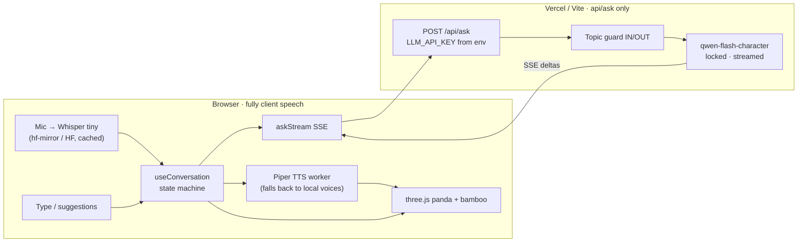

# Bao — Interactive Panda Avatar

Bao only talks about pandas. You ask by voice or by typing; Bao answers out loud, with a living avatar in a bamboo forest. Off-topic questions get a polite refusal.

**[Demo video](docs/demo.mp4)** · **[Architecture](docs/architecture.svg)** · **[Technical discussion Q1–Q6](DISCUSSION.md)**

---

## Demo

[`docs/demo.mp4`](docs/demo.mp4) — ~40s, **1920×1080** with spoken audio.

The clip shows an in-scope question (answer + speaking avatar), then an out-of-scope question (refusal).

---

## Quick start

Node **20+**. Mic optional (typing works). Spoken replies use a voice installed on your OS.

```bash
npm install
cp .env.example .env    # set LLM_API_KEY
npm run dev             # http://localhost:5173
```

Visitors never enter a key — the server uses `LLM_API_KEY`.

| Command | Purpose |
|---|---|
| `npm run dev` | App + `/api/ask` via Vite |
| `npm test` | Unit tests |
| `npm run build && npm start` | Production Node server on port 8787 |
| `npm run eval` | Live topic-guard check |

### Deploy on Vercel

1. Import the Git repo (Framework: **Vite**, output `dist`).
2. In **Project → Settings → Environment Variables**, set:
   - `LLM_API_KEY` — Alibaba Cloud Model Studio key (**required**)
   - `LLM_PROVIDER` — `qwen-intl` (default) or `qwen` for mainland China
3. Deploy. Users open the site and talk — no key in the browser.

The only serverless route is `api/ask.ts`. Speech (Whisper STT + Piper TTS) runs **100% in the browser**, free, with no speech API.

---

## Architecture




**How a turn works**

1. Mic (on-device Whisper) or typed text → `useConversation`
2. `POST /api/ask` (no browser secret)
3. Server streams `qwen-flash-character` with env key; first tokens `[IN]` / `[OUT]`
4. Out of scope → coded refusal
5. In scope → sentence chunker → Piper TTS (worker) → avatar via `signals`

---

## Project map

```
api/ask.ts           Vercel serverless answers (env key)
server/              ask handler, topic guard, Qwen client
shared/protocol.ts   types + locked QWEN_MODEL
src/state/           conversation state machine + hook
src/voice/           Whisper STT and Piper TTS (client), local voice fallback
src/avatar/          panda cutout, shader, lip cues
src/scene/           WebGL canvas + swaying bamboo
src/ui/              mic, strings (EN / FR / 中)
docs/                architecture.svg + demo.mp4
DISCUSSION.md        assignment follow-up Q1–Q6
```

---

## Controls

| Input | Action |
|---|---|
| Mic / **Space** | Talk (Whisper in the browser) |
| Keyboard icon | Type instead |
| **Esc** | Interrupt |
| **EN / FR / 中** | Language |
| **D** | Latency panel |

---

## Design notes (short)

- **One state machine** owns idle → listening → thinking → speaking.
- **Topic lock in code**: model must tag `[IN]`/`[OUT]`; server fails closed. See [DISCUSSION.md § Q5](DISCUSSION.md#q5-topic-restriction).
- **Streaming end-to-end** so Bao starts speaking on the first sentence.
- **API key never in the client** — only Vercel / `.env`.

---

## Configuration

| Setting | Where | Notes |
|---|---|---|
| `LLM_API_KEY` | Vercel env or `.env` | Required for answers |
| `LLM_PROVIDER` | Vercel env or `.env` | `qwen-intl` or `qwen` |
| Answer model | Code only | Always `qwen-flash-character` |

---

## Limits

- The mouth follows a viseme timeline stretched to the audio's exact length, not the waveform.
- The first visit downloads the voice (about 60 MB per language) from hf-mirror (then Hugging Face) into browser storage. Until then, answers use a local voice, or stay silent with a notice.
- Bao's voice is male in English (`en_US-hfc_male`) and French (`fr_FR-tom`). Chinese has no male voice this engine can run: it uses a local male voice if the computer has one, otherwise Huayan, a female voice.
- First mic use downloads Whisper tiny from hf-mirror (then Hugging Face) into the browser cache.
- Local fallback voices never include Google/Online cloud voices.
