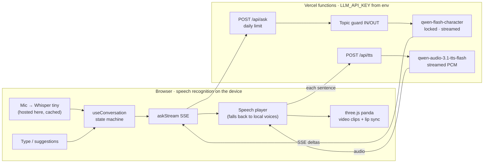

# Bao — Interactive Panda Avatar

Bao only talks about pandas. You ask by voice or by typing; Bao answers out loud, with a living avatar in a bamboo forest. Off-topic questions get a polite refusal.

**Live demo:** [https://bao-the-panda-expert.vercel.app/](https://bao-the-panda-expert.vercel.app/)

**[Demo video](docs/demo.mp4)** · **[Architecture](docs/architecture.svg)** · **[Technical discussion Q1–Q6](DISCUSSION.md)**

---

## Demo

[`docs/demo.mp4`](docs/demo.mp4) — ~40s, **1920×1080** with spoken audio.

The clip shows an in-scope question (answer + speaking avatar), then an out-of-scope question (refusal). It was recorded before the Alibaba voice and the loading screen were added, so the [live demo](https://bao-the-panda-expert.vercel.app) is the current version.

---

## Quick start

Node **20+**. Mic optional (typing works). Answers and Bao's voice both use `LLM_API_KEY`.

```bash
npm install
cp .env.example .env    # set LLM_API_KEY
npm run dev             # http://localhost:5173
```

Visitors never enter a key — the server uses `LLM_API_KEY`.

| Command | Purpose |
|---|---|
| `npm run dev` | App + `/api/ask` and `/api/tts` via Vite |
| `npm test` | Unit tests |
| `npm run build && npm start` | Production Node server on port 8787 |
| `npm run eval` | Live topic-guard check |

### Deploy on Vercel

Production site: [https://bao-the-panda-expert.vercel.app/](https://bao-the-panda-expert.vercel.app/)

1. Import the Git repo (Framework: **Vite**, output `dist`).
2. In **Project → Settings → Environment Variables**, set:
   - `LLM_API_KEY` — Alibaba Cloud Model Studio key (**required**)
   - `LLM_PROVIDER` — `qwen-intl` (default) or `qwen` for mainland China
   - `QWEN_DAILY_LIMIT` — optional cap on questions per day
3. Deploy. Users open the site and talk — no key in the browser.

Serverless routes: `api/ask.ts` (answers) and `api/tts.ts` (voice), both with `LLM_API_KEY`. Speech recognition (Whisper) runs in the browser.

---

## Architecture




**How a turn works**

1. Mic (on-device Whisper) or typed text → `useConversation`
2. `POST /api/ask` (no browser secret)
3. Server streams `qwen-flash-character` with env key; first tokens `[IN]` / `[OUT]`
4. Out of scope → coded refusal
5. In scope → sentence chunker → `/api/tts` (Alibaba `qwen-audio-3.1-tts-flash`, streamed PCM) → avatar via `signals`

---

## Project map

```
api/                 Vercel functions: ask.ts (answers), tts.ts (voice)
server/              ask and TTS handlers, topic guard, Qwen client, daily limit
public/              video clips, lip-sync atlas, Whisper model
shared/protocol.ts   types + locked QWEN_MODEL
src/state/           conversation state machine + hook
src/voice/           Whisper STT (client), streamed TTS player, local voice fallback
src/avatar/          video loops, shader, lip sync
src/scene/           WebGL canvas (keeps the app usable if WebGL fails) + swaying bamboo
src/ui/              loading screen, mic, strings (EN / FR / 中)
src/loading.ts       tracks everything the loading screen waits for
docs/                architecture.svg + demo.mp4
DISCUSSION.md        assignment follow-up Q1–Q6
```

---

## Controls

| Input | Action |
|---|---|
| Mic / **Space** | Talk (Whisper in the browser) |
| Keyboard icon | Type instead |
| **Esc** | Interrupt |
| **EN / FR / 中** | Language |
| **D** | Latency panel |

---

## Design notes (short)

- **One state machine** owns idle → listening → thinking → speaking.
- **Topic lock in code**: model must tag `[IN]`/`[OUT]`; server fails closed. See [DISCUSSION.md § Q5](DISCUSSION.md#q5-topic-restriction).
- **Streaming end-to-end** so Bao starts speaking on the first sentence.
- **API key never in the client** — only Vercel / `.env`.

---

## Configuration

| Setting | Where | Notes |
|---|---|---|
| `LLM_API_KEY` | Vercel env or `.env` | Required for answers |
| `LLM_PROVIDER` | Vercel env or `.env` | `qwen-intl` or `qwen` |
| `QWEN_DAILY_LIMIT` | Vercel env or `.env` | Questions per day for the whole site; empty or 0 means no limit |
| `UPSTASH_REDIS_REST_URL`, `UPSTASH_REDIS_REST_TOKEN` | Vercel env or `.env` | Optional: exact shared count on Vercel |
| Answer model | Code only | Always `qwen-flash-character` |

---

## Limits

- The mouth follows a viseme timeline stretched to the audio's exact length, not the waveform.
- Bao's voice is `xunanchuan_v3.1`, male, with a slightly raised pitch and a "cartoon panda" style instruction. Each sentence is billed to the Model Studio account (about $0.0001 for two sentences); requests are capped in length.
- `QWEN_DAILY_LIMIT` caps questions per day for the whole site, and the count shows at the bottom right. On Vercel it needs Upstash Redis (`UPSTASH_REDIS_REST_URL`, `UPSTASH_REDIS_REST_TOKEN`) to be exact; without it each serverless instance counts alone and the number shows as approximate. It counts questions: `/api/tts` can still be called directly.
- If the voice service fails, answers use a local voice, or stay silent with a notice.
- Whisper tiny ([Xenova/whisper-tiny](https://huggingface.co/Xenova/whisper-tiny), Apache-2.0) is in `public/models`, and its runtime is copied to `public/ort` at build time, so speech recognition needs no third-party host. The first visit downloads about 85 MB, of which 67 MB is Whisper, into the browser cache.
- Whisper tiny is small enough to run in a browser, at a cost: in a test with generated speech, English came out nearly right, French and especially Chinese did not, and transcribing took a few seconds on the CPU. It runs on the main thread, so the avatar can freeze briefly while it works. See [DISCUSSION.md § Q2](DISCUSSION.md#q2-real-time-latency-4-seconds-is-too-slow).
- Local fallback voices never include Google/Online cloud voices.
